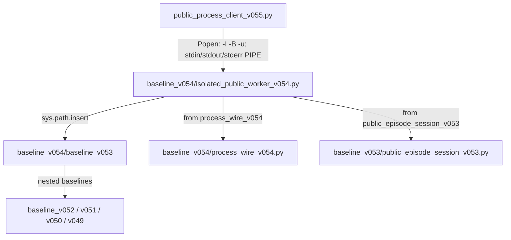

# P0/P1-PROC-05 — Static subprocess and nested-baseline path trace (v0.55)

**Status:** STATIC_REPRODUCED / NOT_RUN.  
**Date:** 2026-10-24.  
**Input:** `EngineYT_Darts_S34_v055_BoundedStdout_Integrated_SourceOnly_PRIVATE.zip` (SHA-256 `3d3e8b721b440362019cb5c025a2a20d7f51ad816ae27f6de6d56181a9304105`).

## Reproduction

- Inspector: `EngineYT_Darts_P0_P1_Process_Path_Trace_2026-10-24.py`, SHA-256 `bde2ec9b88f9395f2e8bd6f2a2521a339e95688e86f046cd30ca20faa0d557b7`.
- Machine-readable AST call trace: `EngineYT_Darts_P0_P1_Process_Path_Trace_2026-10-24.json`, SHA-256 `3efa82b2ac79e00c4f74539da7d0665a816a06b2e24d3a2d681b4f83e98a6c3e`.
- `ast.parse` and `ast.unparse` only; no Darts module execution. 9 call/path observations in the client, 5 in the worker, 5 in the synthetic test fixture.

## Static path and process chain

The arrows indicate **static source references**, not observed process launches. Exact import resolution can be influenced by `sys.path` ordering and environment; no worker was run.

## Line-anchored evidence

- `public_process_client_v055.py:17`: `ROOT = Path(__file__).resolve().parent / 'baseline_v054'`.
- `public_process_client_v055.py:29–34`: Python `-I -B -u`; copy of `os.environ` with `PYTHONPATH` and `PYTHONSTARTUP` removed; `subprocess.Popen` with `cwd=ROOT` and inherited remaining environment.
- `baseline_v054/isolated_public_worker_v054.py:11–16`: worker prepends HERE, v0.53 and nested v0.52/v0.51/v0.50/v0.49 directories to `sys.path`.
- `baseline_v054/isolated_public_worker_v054.py:19–20`: imports `process_wire_v054` and `public_episode_session_v053`.
- `test_transport_v055.py:25–34`: synthetic test creates a temporary directory, copies a fake worker there, overrides `client.ROOT`, and sets a synthetic mode.

## Security implications (bounded claims)

1. `-I` prevents ordinary inherited `PYTHONPATH` influence, but the worker explicitly inserts internal directories into `sys.path`. That is consistent with nested-baseline module reuse and **not** an OS sandbox.
2. The child inherits the parent OS account's permissions unless a separate, actually verified confinement mechanism is applied. The observed `Popen` invocation does not establish such confinement.
3. Parent-side bounded queue retention is not a lifetime stdout emission budget. Synchronous `stdin.write` and `flush` remain outside the subsequent bounded read loop.
4. ACK/COMMITTED from this worker is not independent attestation. Logical FAILED_TERMINAL does not prove the OS process was terminated and its termination confirmed.
5. No Windows SEC-02 test was executed. No demonstration of strict Policy B under model M is claimed.

## Pending

- [x] Identify static client→worker subprocess edge.
- [x] Identify explicit worker nested-baseline `sys.path` edges.
- [x] Identify synthetic fixture root override.
- [ ] Independent Windows SEC-02 execution: **NOT_RUN**; blocked by frozen E5B4D governance.
- [ ] Any new model or test exception requires separate formal gate decision.

**Frozen:** E5B4D_NO-GO; RENDER_NO-GO; PUBLISH_NO-GO. No main merge.
